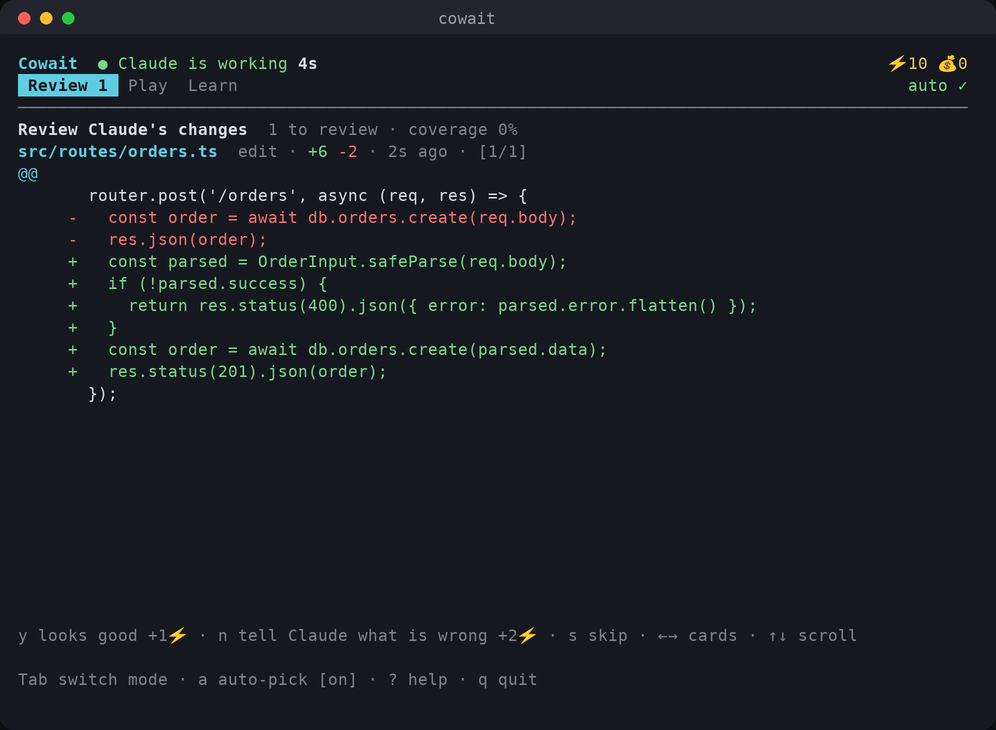
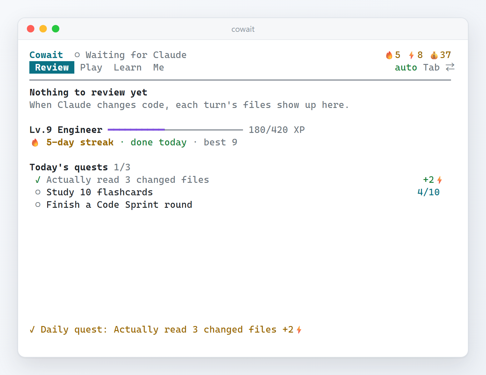
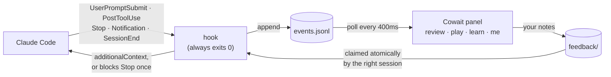

<div align="center">

# Cowait

**Half of working with Claude Code is waiting. Cowait is a small panel in the pane next to it that spends that time on the thing most worth doing: seeing what each Claude turn actually changed. The reward for reading is a quick game, a daily puzzle or a few flashcards.**

**English** · [简体中文](README.zh-CN.md)


<p>


<a href="LICENSE"></a>
</p>

<h3>
<a href="#install">Install</a> ·
<a href="#the-four-tabs">The four tabs</a> ·
<a href="#a-reason-to-come-back-every-day">Every day</a> ·
<a href="#open-source">Open source</a> ·
<a href="#privacy">Privacy</a>
</h3>

</div>

<br>

You type a prompt, Claude Code starts reading, editing, running tests, and you… watch the spinner.
Thirty seconds, two minutes, sometimes ten. It happens dozens of times a day, and the time goes nowhere.

A wave of tools has noticed. Some turn the spinner into a game, some sell it as ad inventory, some
teach you trivia in a side pane. They share one blind spot: **they pull you away from the work**,
and most of them reward you for *waiting longer*, so a run that spins for twenty minutes and produces
nothing still feels great.

Cowait starts from the other end. The most valuable thing you can do while Claude works is **look at
what it is doing**: AI-written code nobody reads is the real cost of agentic coding. So after every
Claude turn, the side panel lists that turn's files, titled with what you asked for. Approve with one
key, or type one line ("keep the 200, the frontend depends on it") and **Claude sees it on its very
next step, without being interrupted**. Once you are through, the same panel has three games built
for waiting and flashcards, and the energy to play is earned by actually reviewing.

> [!TIP]
> No Claude Code needed to try it: `cowait demo` runs a simulated Claude session so you can click
> through every tab. Cowait runs locally: hooks write to a log on your disk and the panel reads it;
> your code and diffs never leave your machine.

<details>
<summary><b>Contents</b></summary>

- [Highlights](#highlights)
- [Install](#install)
- [First run](#first-run)
- [The four tabs](#the-four-tabs)
- [A reason to come back every day](#a-reason-to-come-back-every-day)
- [Two currencies](#two-currencies)
- [Open source](#open-source)
- [How it works](#how-it-works)
- [Commands](#commands)
- [Configuration](#configuration)
- [Privacy](#privacy)
- [Development](#development)
- [Known limitations](#known-limitations)
- [License](#license)

</details>

---

## Highlights

<table>
<tr>
<td width="33%" valign="top"><b>Review by turn</b><br>Each turn has a title (what you asked for), how long it took and whether tests passed, then its files. Several edits to one file are read together. <code>y</code> approves a file, <code>Y</code> the whole turn.</td>
<td width="33%" valign="top"><b>Steer without interrupting</b><br>Write a line about a file (<code>n</code>) or about anything (<code>m</code>). Claude sees it after its next tool call, only in the session or project it is for, and the panel tells you when it arrived.</td>
<td width="33%" valign="top"><b>Only what you read counts</b><br>A change counts as reviewed only if it stayed on screen long enough. An approval in the blink of an eye still approves, but earns nothing and does not count toward coverage, so the number a team lead sees means something.</td>
</tr>
<tr>
<td width="33%" valign="top"><b>Three games built for waiting</b><br>Debug Dungeon (card roguelike), Stack Puzzle (one a day, the same for everyone) and Code Sprint (type real code, often what Claude just wrote). One key per step; stop any time, pauses don't count.</td>
<td width="33%" valign="top"><b>A reason to come back every day</b><br>A daily streak, three daily quests, levels and 21 achievements, a weekly recap. All earned by real reviewing and studying, never by idling.</td>
<td width="33%" valign="top"><b>Understand what Claude just wrote</b><br>Five built-in decks, AI decks on any topic, or a quiz on the code Claude just changed.</td>
</tr>
<tr>
<td width="33%" valign="top"><b>Rewards for results, not minutes</b><br>💰 coins only come from Claude's results: +3 for a turn that did work, +10 more when its tests pass. Waiting longer never pays more.</td>
<td width="33%" valign="top"><b>One key to set up, runs anywhere</b><br>Windows, macOS and Linux. The first run hooks up your project with one key; <code>cowait split</code> opens the pane in Windows Terminal, tmux, zellij, WezTerm, kitty and iTerm2.</td>
<td width="33%" valign="top"><b>Safe to install</b><br>Backs up <code>settings.json</code> before touching it, never touches your own hooks, uninstalls cleanly. The hook always exits 0 within milliseconds and cannot block Claude.</td>
</tr>
</table>

## Install

Needs Node.js 20 or newer:

```bash
npm install -g cowait
```

To update later: `npm install -g cowait@latest`. The panel looks for a new version at most once a day and tells you; so does `cowait update`.

<details>
<summary>Install from source</summary>

`dist/` is prebuilt and committed, so there is no `npm install` and nothing to download:

```bash
git clone https://github.com/JaspinXu/Cowait.git
cd Cowait
npm install -g .      # puts the cowait command on your PATH (or skip it and run node dist/cli.js)
```

To update later: `cowait update --yes` (a `git pull` in the install folder).

</details>

> [!NOTE]
> Standalone binaries (no Node needed) are not published yet. The build and the install scripts (`scripts/install.sh`,
> `scripts/install.ps1`) are ready; once released, it is a one-line install.

## First run

Run `cowait split` in your project folder and the panel opens in a pane to the right of Claude Code (in other terminals, open a pane yourself and run `cowait`; the layout is designed for a narrow pane, 60 columns and up).

The first time, a welcome screen asks:

- **Enter**: hook up this project only (writes the project's `.claude/settings.local.json`)
- **g**: hook up every project (backs up `~/.claude/settings.json` first)
- **Esc**: later; `cowait install` works any time

Restart Claude Code, give it a task, and the panel comes alive. `cowait doctor` checks everything, including a real run of the hook.

## The four tabs

`Tab` switches tabs, `m` writes Claude a note, `a` toggles auto-switching, `?` help, `q` quit.

### Review



One group per turn, newest first. On top: the turn's title (the first line of your message), how long ago, how long it took, whether tests passed; then a row of the turn's files:
`●` waiting, `✓` approved, `✎` noted, `·` approved unread, `–` skipped. Several edits to one file in a turn are shown in order as "edit 1", "edit 2", …

| Key | Does |
|---|---|
| `y` | this file is fine, next one |
| `n` | write Claude one line (it sees it on its next step) |
| `Y` | approve the whole turn: files you read count, unread ones are approved but not counted |
| `s` / `S S` | skip this file / press twice to skip everything |
| `←→` `[ ]` `↑↓` | other file / other turn / scroll the diff |

When Claude finishes a turn, the panel rings and says what happened (time, files, tests, coins); **Enter** jumps to that turn's unread files.
Changes nobody looked at for over a day are archived (counted as skipped), so the queue never becomes a guilt pile.

### Play


Three games, one key per step, drop them the moment Claude is done:

- **Debug Dungeon** (10–20 min a run): a turn-based card roguelike. Fight down 6 floors of bugs and fix the Stack Overflow. The **Heisenbug** dodges your first hit unless you `console.log` it first, the **Memory Leak Blob** grows every turn; your hand is **Rubber Duck**, **git bisect**, **Pair Programming**, **Ship on Friday**… A greedy bot wins about 44% bare, 94% fully geared. Beat it and there is a harder overtime mode (press `o`).
- **Stack Puzzle** (2–5 min): an old machine with only a stack; press buttons until the stack is exactly the goal. **One puzzle a day, the same for everyone**, with a spoiler-free result line to share; `h` gives a hint. Practice puzzles too.
- **Code Sprint** (1 min): type 5 real lines of code. When there is material, the lines are **the code Claude just wrote**, one more look at it. Pauses don't count against your speed.

### Learn


Spaced-repetition flashcards with five built-in bilingual decks: Git, networking and HTTP, OS and concurrency, LLMs and agents, system design.

- `t`: any topic, the AI writes 12 cards.
- `g`: a quiz on **Claude's latest changes**: what changed, why, and what is worth double-checking.

AI decks use a small, cheap model (Haiku): through `ANTHROPIC_API_KEY` if set, otherwise your signed-in `claude` CLI.

### Me



Level and XP, your streak, today's quests, how much Claude did this week and how much of it you read, achievements, and settings (language, bell, auto-switching, note relay, turn titles, update checks) without remembering commands.

## A reason to come back every day

- **Streak 🔥**: a day counts when you read one changed file, study 5 cards or solve the daily puzzle. Playing alone does not count. The 🔥 in the header turns grey while today is still open.
- **Daily quests**: three a day, one each for reviewing, learning and playing, +2⚡ each.
- **Levels and achievements**: XP only comes from useful things (files read, problems flagged, cards studied, puzzles solved), from Intern to Legendary Engineer; 21 achievements from "First Look" to "Second Nature".
- **Weekly recap**: the first time you open the panel in a new week, it tells you how many turns Claude worked last week, how much of it you actually read and how many problems you caught.

## Two currencies

| | Earned by | Spent on |
|---|---|---|
| ⚡ **Energy** | **You**: +1 per file actually read, +2 for a note about a file, +1 per flashcard, +2 per daily quest, +3 per achievement, +5 on the first open of the day, +5 for beating the dungeon. Unread approvals and instant ratings earn nothing | A Debug Dungeon run (3⚡), a Code Sprint round (1⚡), a practice puzzle (1⚡). The daily puzzle is free |
| 💰 **Coins** | **Claude's results only**: +3 for a turn that used tools, +10 more when its tests pass. A chat-only turn earns 0 however long it takes | Permanent Debug Dungeon gear: ergonomic chair, noise-cancelling headphones, espresso machine, second monitor, mechanical keyboard |

## Open source

Cowait is fully open source ([MIT](LICENSE)). Every feature is free; there is no paid tier and no account.

Help make it better:

- **Something feels off, or you want a feature?** Open an [issue](https://github.com/JaspinXu/Cowait/issues) and say what you were doing and what you expected.
- **Want to change the code?** Run `npm test`, then send a PR. For UI changes, look at both languages in a 60-column pane and re-record the pictures with `npm run media`.
- **Working with an AI agent** (Claude Code, Codex, …)? Point it at [`AGENTS.md`](AGENTS.md) first: conventions, architecture and known pitfalls.

If Cowait helps you, a star on the repository helps other Claude Code users find it.

## How it works



- **The hook** is a tiny dependency-free program Claude Code runs on 5 events. It squeezes each payload into one compact log event. It can never block Claude: it always exits 0, with a hard 4-second timeout. On Windows the standalone binary takes about 32 ms per call, the Node version about 50 ms.
- **The panel** folds the log into state: sessions busy or idle, each turn's title and files, rewards, per-day stats. The core is a pure reducer with its own tests. Whatever happened while the panel was closed is caught up quietly, without bells or alerts.
- **Your notes** travel through a small folder, each tagged with the project and Claude session it is for, so with two sessions open, project A's notes never land in project B. After a tool call they reach Claude as `additionalContext`; if Claude is about to stop, Cowait **blocks Stop once** so it handles them first; if Claude is idle, they go along with your next message.
- **Test detection** splits each Bash command at `&&`, `;` and `|`, recognises test runners (`npm test`, `pytest`, `go test`, `cargo test`, …) and reads the summary line for pass or fail.

The whole loop has run end to end with real Claude Code sessions on Linux and Windows 11: Claude received a note and acted on it, Edits arrived with real line numbers, and `npm test` was recognised as passing.

## Commands

| Command | Does |
|---|---|
| `cowait` | open the panel |
| `cowait split` | open the panel in a split (Windows Terminal, tmux, zellij, WezTerm, kitty, iTerm2) |
| `cowait install [--project] [--statusline] [--yes]` | shows exactly what will change and asks first. Installs into `~/.claude/settings.json`, or only the current project with `--project`; `--statusline` also enables a status line (model · folder · 🔥⚡💰 · waiting files) |
| `cowait uninstall [--project]` | remove Cowait's hooks, nothing else |
| `cowait doctor` | check the setup, including a real run of the hook |
| `cowait demo [--fast]` | a simulated Claude session in a throwaway data folder |
| `cowait stats` | level, streak, turns, review coverage, game records |
| `cowait report [--days 7] [--md] [--out file]` | a review report: per day and per project, what Claude changed and what you read |
| `cowait learn "topic" [-n 12]` | have AI write a deck from the command line |
| `cowait update [--yes]` | check for a newer version and print the update command for your install |
>>>>

| `cowait config [key value]` | show or change settings |

## Configuration

Most settings can be switched in the panel under Me → Settings. From the command line: `cowait config <key> <value>`.

| Key | Default | Meaning |
|---|---|---|
| `lang` | `auto` | `zh` / `en` / `auto` (system language) |
| `autoMode` | `true` | switch tabs automatically: changes first, short waits learn, long waits play |
| `feedback` | `true` | relay your notes to Claude |
| `bell` | `true` | ring when Claude finishes or needs you |
| `promptTitles` | `true` | keep the first line of each message as the turn's title (local only) |
| `updateCheck` | `true` | look for a newer version on npm at most once a day |
| `runCost` | `3` | ⚡ per Debug Dungeon run, `0` for free play |
| `shortWaitSec` | `45` | waits predicted shorter than this get flashcards instead of a game |
| `llm` | `auto` | where AI decks come from: `auto` / `anthropic` / `claude-cli` / `off` |
| `model` / `cliModel` | `claude-haiku-5-5` / `haiku` | model for AI decks |

## Privacy

| Install | Data folder |
|---|---|
| npm, standalone binary | `~/.cowait` |
| git clone | `<install folder>/data` |
| custom | the `COWAIT_HOME` environment variable |

**Kept on your machine**: the event log (rotated past 2 MB), panel state, the **first line** of each message you send Claude (up to 60 characters, as the turn's title; can be switched off), Claude's changes (clipped to a few thousand characters), your notes, AI-written decks.
**Never kept**: the rest of your messages, file contents Claude read, command output.

**The only network calls, both optional**: at most one npm lookup a day for a newer version (`updateCheck`); when you ask the AI for a deck, the topic or your last few diffs go to the model. No account, no analytics, no telemetry, no ads.

## Development

Picking this up with an AI agent (Claude Code, Codex, …)? Start with [`AGENTS.md`](AGENTS.md): conventions, architecture, pitfalls and roadmap. The story of each round of work is in [`docs/history/`](docs/history/).

```bash
npm install       # dev dependencies only (TypeScript, Ink, React, esbuild, Vitest)
npm test          # build, then 207 tests: hook protocol, note routing, turn-based review, progress, the three games, the 60-column UI
npm run build     # typecheck + esbuild into dist/cli.js and dist/hook.js (committed, so a clone just works)
npm run compile   # standalone binaries for five platforms into release/, with Bun
npm run media     # re-record docs/media from the real panel (needs Chrome or Edge, and ffmpeg)
node dist/cli.js demo
```

Pushing a `v*` tag runs GitHub Actions: tests, standalone binaries for Windows / macOS / Linux (macOS ones signed), a GitHub Release, and an npm publish when `NPM_TOKEN` is set.

```
src/
  hook.ts / events.ts   the hook Claude Code runs (no dependencies, fast path) and the event format
  feedback.ts           note queue: atomic claims, routed by project and session
  engine/               reducer (turn grouping), economy, progress (streak/quests/achievements/recap), wait prediction, storage
  game/                 Debug Dungeon, Stack Puzzle, Code Sprint (pure, seeded, serialisable)
  learn/                spaced repetition, built-in decks, AI decks
  ui/                   Ink components: App, Review, Game (list), Dungeon, Puzzle, Sprint, Learn, Me
>>>>

  report.ts             review report (HTML / Markdown)
  install.ts / update.ts / runtime.ts   hooking into Claude Code, updates, standalone binaries
scripts/                build, compile, install scripts, media recording
```

## Known limitations

- **It needs a second pane.** Claude Code owns its terminal, so Cowait lives next to it.
- **Restart Claude Code after installing.** Running sessions don't reload hooks.
- **A note left as a turn ends makes Claude run one more step.** That is how the Stop hook lets it act on your note. Turn note relay off in settings if you'd rather not.
- **Interrupted turns.** When you press Esc, Claude Code sends no Stop event; Cowait marks the session idle after 15 quiet minutes.
- **"Read" is a heuristic.** It knows how long a change was on screen, not where your eyes were.
- **Test detection is a heuristic.** Unknown test runners count as ordinary commands (no bonus, no penalty).
- **One panel at a time.** A lock file keeps a second panel from settling rewards twice.

## License

[MIT](LICENSE)
