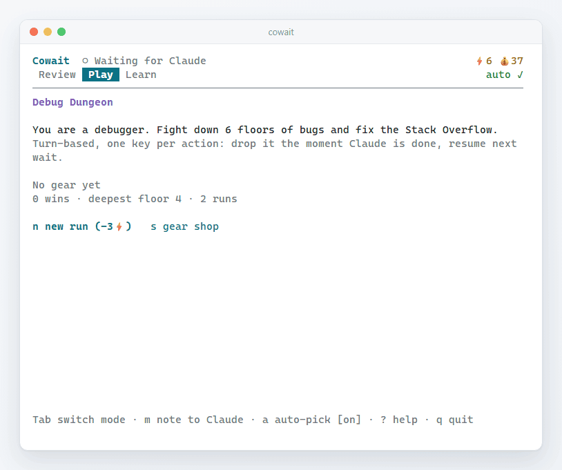
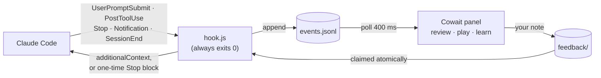
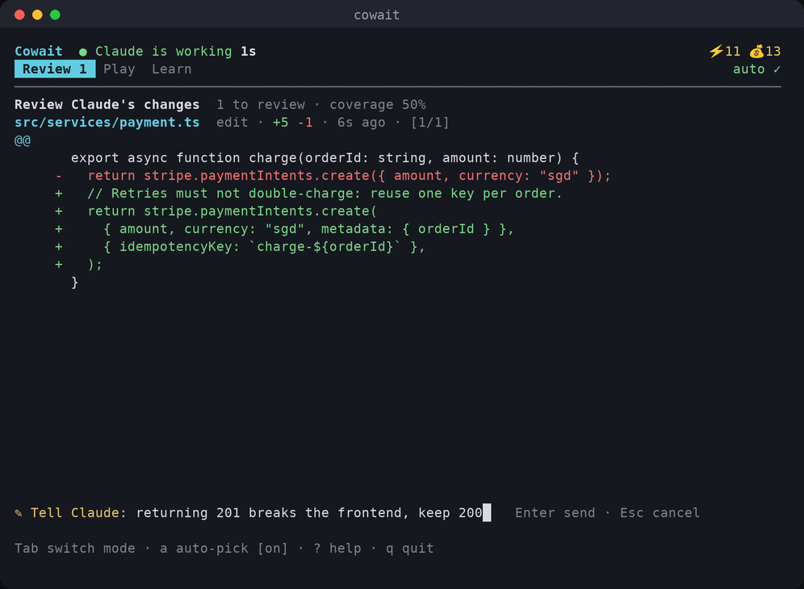
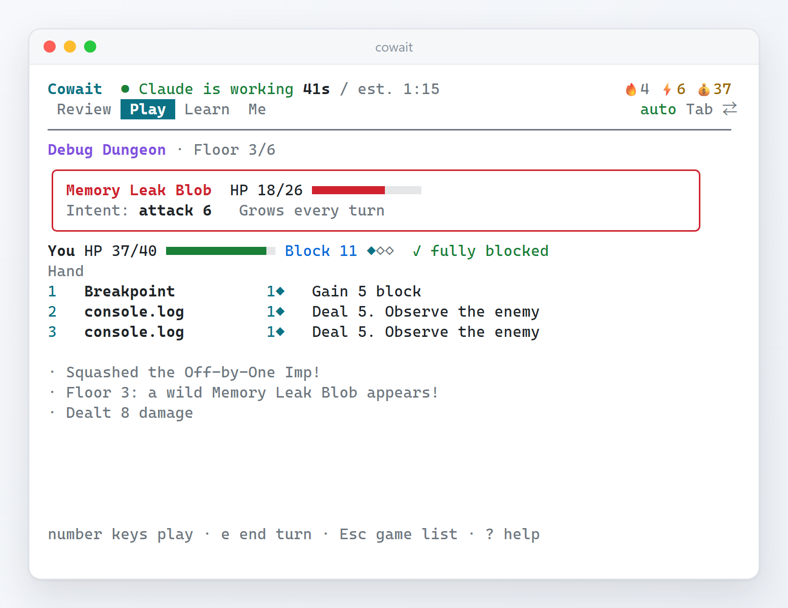
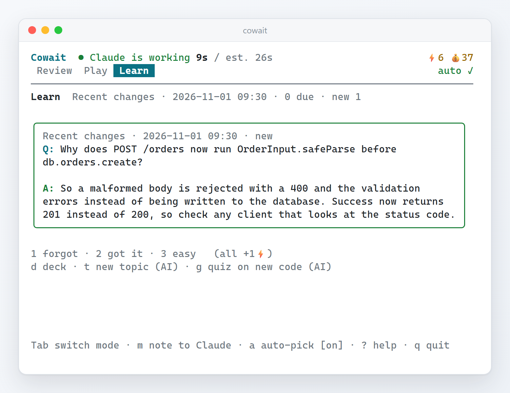

<div align="center">

# Cowait

**Half of working with Claude Code is waiting. Spend it reviewing what Claude just wrote, playing a tiny roguelike, or learning something.**

**English** · [简体中文](README.zh-CN.md)



<p>


<a href="LICENSE"></a>
</p>

<h3>
<a href="#quick-start">Quick start</a> ·
<a href="#how-it-works">How it works</a> ·
<a href="#the-three-modes">The three modes</a> ·
<a href="#two-currencies">Two currencies</a> ·
<a href="#known-limitations">Known limitations</a>
</h3>

</div>

<br>

You type a prompt, Claude Code starts reading, editing, running tests, and you… watch the spinner.
Thirty seconds, two minutes, sometimes ten. It happens dozens of times a day, and the time goes nowhere.

A wave of tools has noticed. Some turn the spinner into a game, some sell it as ad inventory, some
teach you trivia in a side pane. They all share one blind spot: **they pull you away from the work**,
and most of them reward you for *waiting longer*, so a run that spins for twenty minutes and produces
nothing still feels great.

Cowait starts from the opposite end. The most valuable thing you can do while Claude works is
**look at what it is doing**: AI-written code nobody reads is the real cost of agentic coding.
So every edit Claude makes lands in a side panel as a small diff card. Approve it with one key, or
type one line ("keep the 200, the frontend depends on it") and **Claude receives your note on its very
next step, without being interrupted**. Once the queue is clear, the same panel gives you a turn-based
card game or flashcards, and the game is paid for by reviewing.

> [!TIP]
> No Claude Code needed to try it: `cowait demo` runs a simulated Claude session so you can click
> through every mode. Cowait is fully local: hooks write to a log on your disk, the panel reads it,
> nothing is sent anywhere unless you ask the AI to write you a flashcard deck.

<details>
<summary><b>Contents</b></summary>

- [Highlights](#highlights)
- [Quick start](#quick-start)
- [How it works](#how-it-works)
- [The three modes](#the-three-modes)
- [Two currencies](#two-currencies)
- [Auto mode](#auto-mode)
- [Commands](#commands)
- [Configuration](#configuration)
- [Where your data lives](#where-your-data-lives)
- [Development](#development)
- [Known limitations](#known-limitations)
- [License](#license)

</details>

---

## Highlights

<table>
<tr>
<td width="33%" valign="top"><b>Review while it works</b><br>Every Edit / Write / MultiEdit becomes a diff card with real line numbers. <code>y</code> approves, <code>n</code> lets you write Claude one line.</td>
<td width="33%" valign="top"><b>Steer without interrupting</b><br>Your note is injected into Claude's context after its next tool call. If it was about to stop, it gets one more turn to address it. No Esc, no lost work.</td>
<td width="33%" valign="top"><b>Review first, then play</b><br>Starting a game costs ⚡ energy, and energy comes from reviewing and studying. Slacking off and supervising the AI are the same loop.</td>
</tr>
<tr>
<td width="33%" valign="top"><b>Paid for outcomes, not minutes</b><br>💰 coins come only from Claude's results: a turn that did real work, a bonus when tests pass. Waiting longer never pays more.</td>
<td width="33%" valign="top"><b>A game built for waiting</b><br>Debug Dungeon: a turn-based card roguelike, one keypress per action, saved on every move. Drop it the instant Claude is done.</td>
<td width="33%" valign="top"><b>Learn what Claude just wrote</b><br>Five built-in decks plus AI decks on any topic, or a quiz generated from Claude's latest changes, so you actually understand them.</td>
</tr>
<tr>
<td width="33%" valign="top"><b>Picks the right thing for the wait</b><br>Predicts this turn's length from your history in the same project: changes to review come first, short waits get flashcards, long ones a game.</td>
<td width="33%" valign="top"><b>Never misses the moment</b><br>Rings the bell and pops an alert when Claude finishes or needs your approval, even while you are mid-battle.</td>
<td width="33%" valign="top"><b>Safe to install</b><br>Backs up <code>settings.json</code>, leaves your own hooks untouched, uninstalls cleanly. Hooks always exit 0 within milliseconds and can never block Claude.</td>
</tr>
</table>

## Quick start

Requires **Node.js 20+** and Claude Code. Nothing else: Cowait ships as two self-contained files in
`dist/`, so there is no `npm install` and no dependency to download.

```bash
git clone https://github.com/JaspinXu/Cowait.git
cd Cowait
npm install -g .     # puts `cowait` on your PATH (or skip this and run `node dist/cli.js`)

cowait install --project   # try it in one project first: writes only .claude/settings.local.json
cowait install             # …or for every project; shows what it will change, asks, backs up
cowait doctor              # checks Node, the hooks, and runs the hook once for real
```

Restart any running Claude Code sessions so they pick up the hooks, then open the panel **next to**
Claude Code:

| Terminal | How |
|---|---|
| Windows Terminal | `cowait split`: opens the panel in a split pane on the right |
| tmux | `cowait split` |
| anything else | open a second tab or window and run `cowait` |

Just want to look around? `cowait demo` (or `cowait demo --fast`).

> [!NOTE]
> A cloned install keeps all of its data in `<install folder>/data`, so if you clone it onto `G:\`, nothing
> is written to your system drive except the few lines added to Claude Code's `settings.json`.

## How it works



- **The hook** is a tiny dependency-free script Claude Code runs on five events. It turns the payload into a compact event (prompt text and file *reads* are never stored; edits are clipped) and appends it to a log. It never blocks: it always exits 0 and has a 4-second hard stop.
- **The panel** folds the log into state: sessions busy/idle, turn durations, diff cards, rewards. A pure reducer, unit-tested on its own.
- **Notes back to Claude** go through a folder of small files. The hook *claims* them with an atomic rename, so parallel tool calls never deliver a note twice. After a tool call they arrive as `additionalContext`; at `Stop`, Cowait blocks the stop **once** (guarded by `stop_hook_active`, so it can never loop) so Claude can act on them; if Claude is idle, they ride along with your next prompt.
- **Test runs** are recognised by parsing each Bash command segment by segment (`npm test`, `pytest`, `go test`, `cargo test`, `uv run pytest`, `./gradlew test`, …) and reading the runner's summary line.

This was verified end to end against real Claude Code sessions on **Linux and Windows 11**: a note written in the panel was delivered and Claude carried it out (it added the comment the note asked for), its Edit arrived with real line numbers, and `npm test` was scored as a pass. On Windows the hook takes about 47 ms per call, 39 ms of which is Node starting up.

## The three modes

`Tab` switches modes. `a` toggles auto mode, `?` shows help, `q` quits.

### Review



Each change Claude makes is a card: file, kind, `+/-` counts, age, and the diff. `y` looks good (+1⚡),
`n` writes Claude a note (+2⚡), `s` skips, `←/→` moves between cards, `↑/↓` scrolls. The header keeps
a running **human review coverage of AI code**, the number a team lead actually wants (`cowait stats`).

### Play: Debug Dungeon



You are a debugger fighting down six floors of bugs to fix the **Stack Overflow**. Each enemy is a
real bug with a mechanic: the *Heisenbug* dodges your first hit each turn unless you observe it
with `console.log`, the *Memory Leak Blob* grows every turn, the *Race Condition*'s intent can't be
read, the *Deadlock Warden* locks up, then strikes. Cards are dev moves: *Rubber Duck*, *git bisect*
(huge against a Vulnerable bug), *Pair Programming* (next attack doubles), *rm -rf* (20 damage, hurts
you too), *Ship on Friday* (14 damage, and an *Incident* card clogs your deck).

Everything is turn-based and saved on every keypress. Balance is tested: a simple greedy bot wins
about 44% of runs with no gear and about 94% with all of it.

### Learn



Spaced repetition (Leitner boxes) over five built-in decks: Git, networking & HTTP, OS & concurrency,
LLMs & agents, and system design, each in English and Chinese. Plus:

- `t`: type any topic and an AI writes a 12-card deck for it.
- `g`: an AI writes questions about **the changes Claude just made**: what changed, why, which
  APIs are involved, what to double-check.

AI decks use `ANTHROPIC_API_KEY` if set, otherwise the `claude` CLI you are already signed into
(`claude -p`, run so that Cowait's own hooks ignore it).

## Two currencies

| | Earned by | Spent on |
|---|---|---|
| ⚡ **Energy** | **You**: +1 per approved change, +2 per note to Claude, +1 per flashcard, +5 on the first open of the day, +5 for clearing the dungeon | Starting a Debug Dungeon run (3⚡, configurable, `0` = free play) |
| 💰 **Coins** | **Claude's outcomes**: +3 for a turn that used tools, +10 more when tests passed in it. A chat-only turn earns nothing, however long it took | Permanent gear: Ergonomic Chair, Noise-Cancelling Headphones, Espresso Machine, Second Monitor, Mechanical Keyboard |

## Auto mode

At the start of each Claude turn Cowait predicts how long it will take (median of your recent turns in
the same folder) and picks:

1. **Review** if any changes are waiting, and whenever fresh changes arrive (unless you're mid-fight or typing)
2. **Learn** if the wait looks short (under 45 s by default)
3. **Play** otherwise, if you have the energy

When Claude finishes or needs approval, the panel rings and shows an alert. The first key only
dismisses it, so a stray keypress never plays a card by accident, and an alert that appears while
you are typing a note never eats a keystroke.

## Commands

| Command | What it does |
|---|---|
| `cowait` | Open the panel |
| `cowait install [--project] [--statusline] [--force] [--yes]` | Lists exactly what it will change and asks before writing anything. Adds the hooks to `~/.claude/settings.json`, or `.claude/settings.local.json` with `--project`. `--statusline` also adds a Claude Code status line (model · folder · ⚡ 💰 · cards to review); an existing status line is kept unless `--force`, and restored on uninstall |
| `cowait uninstall [--project]` | Remove Cowait's hooks; everything else is left as it was |
| `cowait doctor` | Check Node, the hook script, the settings, run the configured hook command for real, show the data folder and AI provider |
| `cowait demo [--fast]` | Simulated Claude session in a throwaway data folder |
| `cowait split` | Open the panel in a Windows Terminal or tmux split |
| `cowait learn "topic" [-n 12]` | Generate a flashcard deck from the command line |
| `cowait stats` | Turns, test passes, review coverage, notes relayed, game record |
| `cowait config [key value]` | Show or change settings |

## Configuration

`cowait config` prints the file; `cowait config <key> <value>` changes one key.

| Key | Default | Meaning |
|---|---|---|
| `lang` | `auto` | `zh` / `en` / `auto` (system locale) |
| `autoMode` | `true` | Pick a mode automatically each turn (`a` toggles it in the panel) |
| `runCost` | `3` | ⚡ to start a game run; `0` for free play |
| `feedback` | `true` | Relay review notes to Claude |
| `bell` | `true` | Ring when Claude finishes or needs you |
| `shortWaitSec` | `45` | Predicted waits shorter than this get flashcards instead of the game |
| `llm` | `auto` | `auto` / `anthropic` / `claude-cli` / `off` for AI decks |
| `model` | `claude-haiku-5-5` | Model used with `ANTHROPIC_API_KEY` |
| `cliModel` | `haiku` | Model alias passed to `claude -p` |

## Where your data lives

| Install | Data folder |
|---|---|
| Cloned (`git clone`, with or without `npm install -g .`) | `<install folder>/data` |
| Global npm install | `~/.cowait` |
| Override | `COWAIT_HOME=/any/path` |

Inside: `events.jsonl` (rotated at 2 MB), `state.json`, `config.json`, `feedback/` (notes waiting for
Claude), `decks/` (AI decks). What is **not** stored: your prompt text, the contents of files Claude
reads, command output. Edits are clipped to a few thousand characters. Nothing leaves your machine
except when you ask for an AI deck, which sends the topic, or for `g` a few recent diffs, to the model.

## Development

Working on Cowait with an AI agent (Claude Code, Codex, …)? It reads [`AGENTS.md`](AGENTS.md) first: conventions, architecture, pitfalls and the roadmap. The full story of how the project started is in [`docs/history/`](docs/history/).

```bash
npm install       # dev dependencies only (TypeScript, Ink, React, esbuild, Vitest)
npm test          # bundles, then 64 tests: hook protocol, reducer, installer, game balance, UI interaction
npm run build     # type-check, then esbuild → dist/cli.js + dist/hook.js (committed, so clones run as-is)
node dist/cli.js demo
```

```
src/
  hook.ts            the hook Claude Code runs (dependency-free, fast path)
  events.ts          hook payload → compact event
  feedback.ts        note queue with atomic claiming
  testdetect.ts      is this Bash command a test run, and did it pass?
  install.ts         settings.json merge / unmerge
  engine/            reducer, economy, wait prediction, diff rendering, store
  game/              Debug Dungeon (pure, seeded, serialisable)
  learn/             spaced repetition, built-in decks, AI deck generation
  ui/                Ink components: App, Review, Game, Learn
```

## Known limitations

- **It needs a second pane.** Claude Code owns its terminal; Cowait lives next to it. `cowait split` automates this only for Windows Terminal and tmux.
- **Restart Claude Code after installing.** Running sessions do not reload hooks.
- **A note sent at the very end of a turn costs one extra turn.** That is how the Stop hook lets Claude act on it. Turn off with `cowait config feedback false`.
- **Interrupted turns.** If you press Esc, Claude Code sends no Stop event; Cowait marks the session idle after 15 silent minutes.
- **Test detection is a heuristic.** Unknown runners count as plain commands (no bonus, no penalty).
- **Pass/fail of failing commands.** Depending on the Claude Code version, a command that exits non-zero may not trigger `PostToolUse`; Cowait then simply doesn't award the test bonus.
- **One panel at a time.** A lock file stops a second panel, which would double-count rewards.

## License

[MIT](LICENSE)
