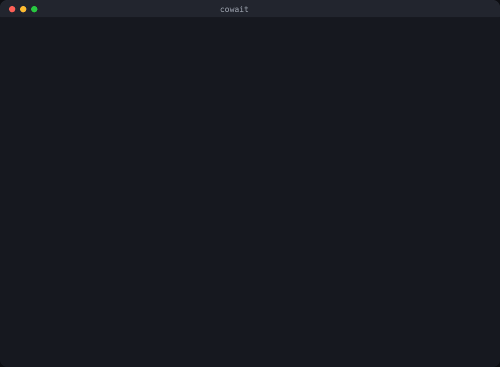
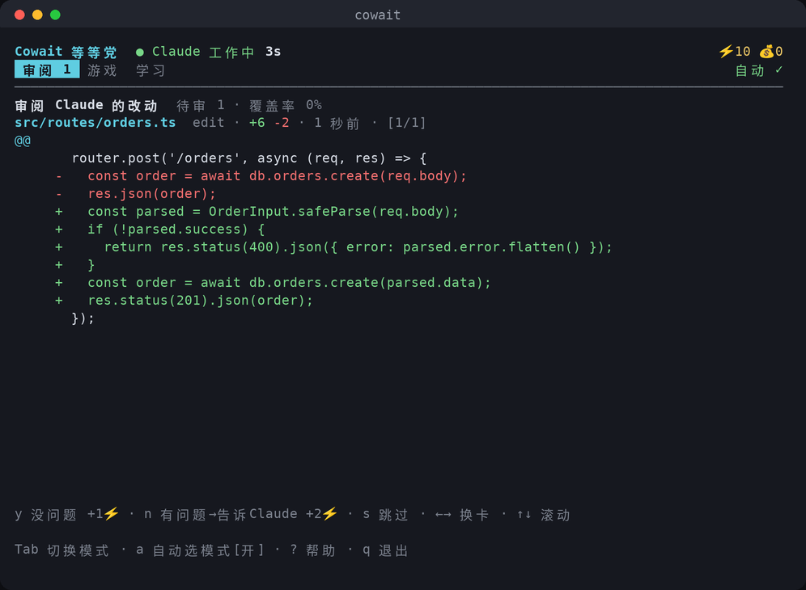
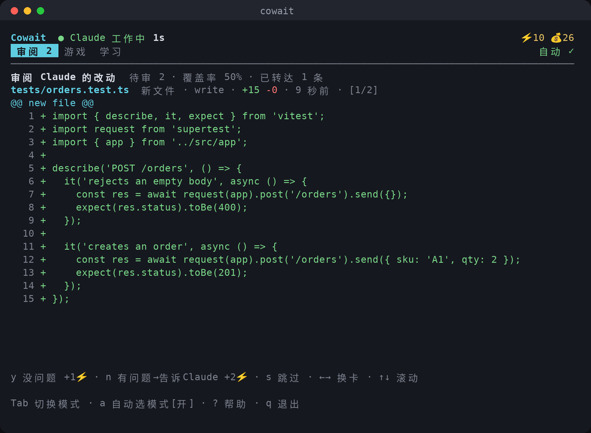
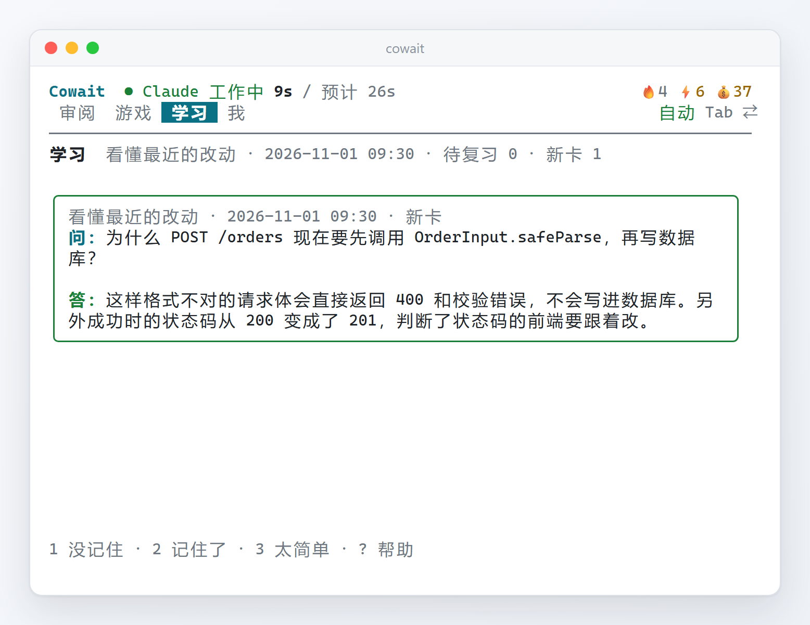
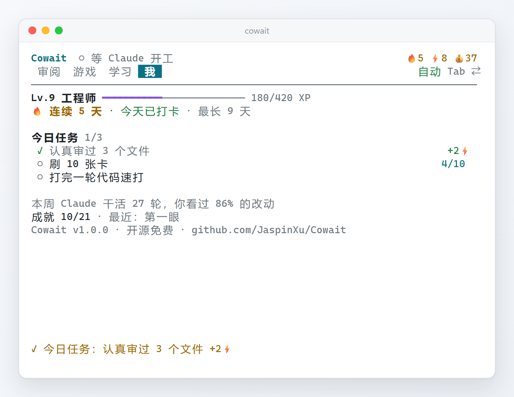
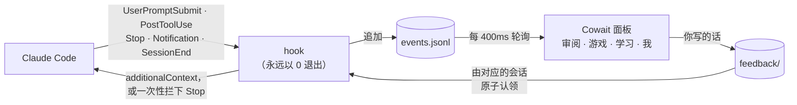

<div align="center">

# Cowait

**用 Claude Code 写代码，一半时间都在等。Cowait 是放在旁边分屏里的小面板：把这段时间花在最值得的事上，看懂 Claude 每一轮改了什么。看完的奖励，是一局小游戏、一道每日谜题或几张抽认卡。**

[English](README.md) · **简体中文**



<p>


<a href="LICENSE"></a>
</p>

<h3>
<a href="#安装">安装</a> ·
<a href="#四个页面">四个页面</a> ·
<a href="#每天都有理由回来">每天都有理由回来</a> ·
<a href="#开源">开源</a> ·
<a href="#隐私">隐私</a>
</h3>

</div>

<br>

你敲下一句 prompt，Claude Code 开始读文件、改代码、跑测试，而你……盯着那个转圈的动画。
三十秒、两分钟，有时候十分钟。一天几十次，这些时间就这么没了。

已经有一波工具盯上了这段时间：有的把它做成小游戏，有的当成广告位卖，有的在旁边教你冷知识。
但它们有同一个盲点：**都在把你从工作里拉走**，而且大多按“等了多久”给奖励，
一个空转二十分钟、什么都没干成的回合，反而让人最爽。

Cowait 反过来想。等 Claude 干活时，最有价值的事是**看看它在干什么**：没人看过的 AI 代码，才是 agent 编程真正的隐性成本。
所以 Claude 每干一轮，旁边的面板就按文件列出这一轮改了什么，标题就是你当时说的那句话。
按一个键说“没问题”，或者打一句话（“这里别改成 201，前端依赖 200”），**Claude 下一步操作时就会看到，不用打断它**。
看完了，同一个面板里有三个为等待设计的小游戏和抽认卡，而开游戏的能量，靠认真审代码来赚。

> [!TIP]
> 没装 Claude Code 也能先试：`cowait demo` 会模拟一个正在干活的 Claude，四个页面都能点一遍。
> Cowait 在本地运行：hook 把事件写进你硬盘上的日志，面板去读它，代码和改动不会离开你的电脑。

<details>
<summary><b>目录</b></summary>

- [功能亮点](#功能亮点)
- [安装](#安装)
- [第一次打开](#第一次打开)
- [四个页面](#四个页面)
- [每天都有理由回来](#每天都有理由回来)
- [两种货币](#两种货币)
- [开源](#开源)
- [它是怎么工作的](#它是怎么工作的)
- [命令](#命令)
- [配置](#配置)
- [隐私](#隐私)
- [开发](#开发)
- [已知限制](#已知限制)
- [License](#license)

</details>

---

## 功能亮点

<table>
<tr>
<td width="33%" valign="top"><b>按轮审阅</b><br>每一轮一个标题（你当时说的那句话）、用时、测试过没过，下面是这一轮改过的文件。同一个文件改了几次就合在一起看。<code>y</code> 通过，<code>Y</code> 整轮通过。</td>
<td width="33%" valign="top"><b>不打断也能纠偏</b><br>针对某个文件写一句（<code>n</code>），或者随时想到什么就写（<code>m</code>）。Claude 下一次调用工具时就会看到，只送给对应项目里的会话，送达后面板会告诉你。</td>
<td width="33%" valign="top"><b>看过的才算审过</b><br>只有在屏幕上停留够久的改动才算“审过”。还没看清就按下的通过照样生效，但不加能量、不计入覆盖率。团队负责人看到的数字才可信。</td>
</tr>
<tr>
<td width="33%" valign="top"><b>为等待设计的三个游戏</b><br>捉虫地牢（卡牌闯关）、栈机谜题（每天一道，人人同题）、代码速打（打的可以是 Claude 刚写的代码）。一个键一步，随时能停，停下的时间不算。</td>
<td width="33%" valign="top"><b>每天都有理由回来</b><br>连续天数、三个今日任务、等级和 21 个成就、每周一份回顾。全都来自真实的审阅和学习，不来自挂机。</td>
<td width="33%" valign="top"><b>看懂 Claude 刚写的代码</b><br>5 个内置卡组、AI 按任意主题出题，或者直接用 Claude 刚改的代码出题考你。</td>
</tr>
<tr>
<td width="33%" valign="top"><b>按成果给奖励，不按时长</b><br>💰 金币只看 Claude 的成果：真正干活的一轮 +3，测试通过再 +10。等再久也不会多给。</td>
<td width="33%" valign="top"><b>按一个键接入，到处能跑</b><br>Windows、macOS、Linux 都能用。第一次打开按一下 Enter 就接入当前项目；<code>cowait split</code> 能在 Windows Terminal、tmux、zellij、WezTerm、kitty、iTerm2 里自动分屏。</td>
<td width="33%" valign="top"><b>放心安装</b><br>改 <code>settings.json</code> 前先备份，不碰你自己的 hooks，卸载得干干净净。hook 永远以 0 退出、几十毫秒内结束，不可能卡住 Claude。</td>
</tr>
</table>

## 安装

需要 Node.js 20 或更新版本：

```bash
npm install -g cowait
```

以后升级：`npm install -g cowait@latest`。面板每天最多查一次有没有新版本，有的话会提示你；`cowait update` 也会告诉你。

<details>
<summary>从源码安装</summary>

`dist/` 已经打包好并提交在仓库里，不需要 `npm install`，也不用下载任何依赖：

```bash
git clone https://github.com/JaspinXu/Cowait.git
cd Cowait
npm install -g .      # 把 cowait 命令加到 PATH（也可以跳过，直接 node dist/cli.js）
```

以后升级：`cowait update --yes`（就是在安装目录里 `git pull`）。

</details>

> [!NOTE]
> 不需要 Node 的独立可执行文件还没有发布。打包和安装脚本（`scripts/install.sh`、`scripts/install.ps1`）都已经写好，发布后一条命令就能装上。

## 第一次打开

在你的项目目录里运行 `cowait split`，面板会在 Claude Code 右边分屏打开（其他终端里，自己开一个窗格运行 `cowait` 就行；界面按窄分屏设计，60 列以上都能用）。

第一次打开会看到欢迎页：

- **Enter**：只为这个项目接入（写入这个项目的 `.claude/settings.local.json`）
- **g**：为所有项目接入（先备份 `~/.claude/settings.json` 再改）
- **Esc**：以后再说；随时可以运行 `cowait install`

接入后重启 Claude Code，给它派个活，面板就动起来了。`cowait doctor` 会自检一遍（真的跑一次 hook）。

## 四个页面

`Tab` 切换页面，`m` 给 Claude 留言，`a` 开关自动切换，`?` 帮助，`q` 退出。

### 审阅



一轮一组，最新的一轮在前。顶上是这一轮的标题（你当时说的那句话的第一行）、多久以前、用时、测试过没过，下面一排是这一轮改过的文件：
`●` 待审、`✓` 通过、`✎` 写了留言、`·` 没看就过、`–` 跳过。同一个文件在这一轮里改了几次，就按“第 1 处”“第 2 处”依次排开。

| 按键 | 作用 |
|---|---|
| `y` | 这个文件没问题，跳到下一个 |
| `n` | 写一句话给 Claude（它下一步就会看到） |
| `Y` | 整轮通过：看过的文件算审过，没看的照样通过但不算 |
| `s` / `S S` | 跳过这个文件 / 连按两次跳过全部 |
| `←→` `[ ]` `↑↓` | 换文件 / 换一轮 / 滚动 diff |

Claude 干完一轮时，面板响铃并弹出提醒（用时、改了几个文件、测试结果、拿了多少金币），按 **Enter** 直接跳到这一轮还没看的文件。
放了一天多没人看的改动会自动归档（算跳过），待审列表不会越堆越多。

### 游戏



三个游戏，都是一个键一步、随时能停，Claude 一干完就能放下：

- **捉虫地牢**（一局 10–20 分钟）：回合制卡牌闯关，往下打穿 6 层 Bug，最后修好「栈溢出」。**海森堡虫**没被 `console.log` 观测时会躲开你的第一下，**内存泄漏团**每回合都在长大；手牌是**小黄鸭**、**git bisect**、**结对编程**、**周五上线**……裸装通关率约 44%，满装备约 94%。打通了还有更难的「加班模式」（按 `o`）。
- **栈机谜题**（2–5 分钟）：一台只有栈的老机器，按按钮让栈正好变成目标的样子。**每天一道，所有人同一题**，解出来可以复制一行不剧透的战绩分享出去；卡住了按 `h` 看提示。另外还能做练习题。
- **代码速打**（1 分钟）：照着打 5 行真实的代码。只要有素材，打的就是 **Claude 刚写的代码**，顺便又看了一遍。停下的时间不算进速度。

### 学习



间隔重复的抽认卡，内置 5 个中英双语卡组：Git 进阶、网络与 HTTP、操作系统与并发、LLM 与 Agent、系统设计。

- `t`：输入任意主题，AI 出 12 张卡。
- `g`：AI 根据 **Claude 刚刚的改动**出题：改了什么、为什么改、哪里值得再确认。

AI 出题用便宜的小模型（Haiku）：有 `ANTHROPIC_API_KEY` 就走 API，没有就用你已经登录的 `claude` 命令。

### 我



等级和经验、连续天数、今日任务、本周 Claude 干了多少活而你看了多少、成就，还有设置（语言、响铃、自动切换、留言转达、记录标题、检查更新），不用再记命令。

## 每天都有理由回来

- **连续天数 🔥**：认真审过一个文件、刷 5 张卡或者解出每日谜题，这一天就算数。只是玩游戏不算。今天还没打卡时，标题栏的 🔥 会变灰提醒你。
- **今日任务**：每天三个，一个关于审阅、一个关于学习、一个关于游戏，完成各 +2⚡。
- **等级和成就**：经验只来自有用的事（审过的文件、标出的问题、刷的卡、解出的谜题），从“实习生”一路升到“传奇工程师”；21 个成就，从「第一眼」到「习惯成自然」。
- **每周回顾**：每周第一次打开时，告诉你上周 Claude 干了多少轮、你认真看了其中多少、标出了几个问题。

## 两种货币

| | 怎么赚 | 怎么花 |
|---|---|---|
| ⚡ **能量** | **靠你自己**：认真审过一个文件 +1，针对文件给 Claude 写一句话 +2，刷一张卡 +1，今日任务 +2，成就 +3，每天第一次打开 +5，通关地牢 +5。没看就过、一眨眼就打分的不算 | 开一局捉虫地牢（3⚡）、代码速打（1⚡）、练习谜题（1⚡）。每日谜题免费 |
| 💰 **金币** | **只看 Claude 的成果**：真正干活的一轮 +3，这一轮测试通过再 +10。只聊天不干活的一轮，等多久都是 0 | 捉虫地牢的永久装备：人体工学椅、降噪耳机、意式咖啡机、双显示器、机械键盘 |

## 开源

Cowait 完全开源（[MIT](LICENSE)），所有功能都免费，没有付费版，也没有账号。

欢迎一起改进它：

- **用着哪里别扭、想要什么功能**，开一个 [issue](https://github.com/JaspinXu/Cowait/issues)，说说当时在做什么、期望发生什么。
- **想直接改代码**，先跑一遍 `npm test`，再提 PR。界面改动请在 60 列宽的窄分屏里看一眼中英文两种语言，并用 `npm run media` 重录配图。
- **用 AI agent 开发**（Claude Code、Codex 等）：让它先读 [`AGENTS.md`](AGENTS.md)，约定、架构和踩过的坑都在里面。

觉得有用的话，给仓库点个 Star，能让更多用 Claude Code 的人看到它。

## 它是怎么工作的



- **hook** 是一个没有任何依赖的小程序，Claude Code 在 5 个事件上调用它，把 payload 压成一条紧凑的事件追加到日志里。它永远不会卡住 Claude：始终以 0 退出，带 4 秒硬超时。在 Windows 上，独立可执行文件版本每次约 32 毫秒，Node 版本约 50 毫秒。
- **面板**把日志折叠成状态：会话忙/闲、每一轮的标题和文件、奖励结算、每天的统计。核心是一个纯函数 reducer，单独有测试。面板关着时发生的事，重新打开后会安静地补上，不响铃也不弹提醒。
- **你写给 Claude 的话**通过一个小文件夹传递，每条都标着它属于哪个项目、哪个 Claude 会话；同时开着两个会话时，A 项目的话不会被送进 B 项目。工具调用之后，这些话以 `additionalContext` 送到 Claude 面前；如果 Claude 正要结束，Cowait 会**只拦一次** Stop 让它先处理；如果 Claude 已经闲着，就跟你下一条消息一起带过去。
- **测试识别**：把每条 Bash 命令按 `&&`、`;`、`|` 拆成段逐段判断（`npm test`、`pytest`、`go test`、`cargo test` 等），再读测试框架的汇总行判断通过与否。

这套流程在 Linux 和 Windows 11 上都跟真实的 Claude Code 会话完整跑通过：留言送达后 Claude 照做了，Edit 带着真实行号进来，`npm test` 被判定为通过。

## 命令

| 命令 | 作用 |
|---|---|
| `cowait` | 打开面板 |
| `cowait split` | 在右侧分屏打开面板（Windows Terminal、tmux、zellij、WezTerm、kitty、iTerm2） |
| `cowait install [--project] [--statusline] [--yes]` | 先列出会改哪些东西，问你确认后才动手。默认装到 `~/.claude/settings.json`，`--project` 只装当前项目；`--statusline` 同时启用状态栏（模型 · 目录 · 🔥⚡💰 · 待审数） |
| `cowait uninstall [--project]` | 移除 Cowait 的 hooks，其他配置原样保留 |
| `cowait doctor` | 自检：hook 程序、配置，并真的执行一次 hook |
| `cowait demo [--fast]` | 在临时数据目录里模拟一个 Claude 会话 |
| `cowait stats` | 统计：等级、连续天数、轮次、审阅覆盖率、游戏战绩 |
| `cowait report [--days 7] [--md] [--out 文件]` | 生成审阅报告：每天、每个项目，Claude 改了多少、你认真看了多少 |
| `cowait learn "主题" [-n 12]` | 在命令行里让 AI 出一组卡 |
| `cowait update [--yes]` | 检查新版本，给出对应安装方式的升级命令 |
>>>>

| `cowait config [键 值]` | 查看或修改配置 |

## 配置

大部分设置在面板的「我 → 设置」里直接切换。命令行：`cowait config <键> <值>`。

| 键 | 默认 | 含义 |
|---|---|---|
| `lang` | `auto` | `zh` / `en` / `auto`（跟随系统语言） |
| `autoMode` | `true` | 自动切换页面：有改动先审，等得短刷卡，等得长玩游戏 |
| `feedback` | `true` | 是否把留言转达给 Claude |
| `bell` | `true` | Claude 完成或需要你时响铃 |
| `promptTitles` | `true` | 记录你每条消息的第一行作为这一轮的标题（只存本机） |
| `updateCheck` | `true` | 每天最多查一次 npm 上有没有新版本 |
| `runCost` | `3` | 开一局捉虫地牢要几 ⚡，`0` 为免费畅玩 |
| `shortWaitSec` | `45` | 预计等待短于这个秒数时用刷卡代替游戏 |
| `llm` | `auto` | AI 出题来源：`auto` / `anthropic` / `claude-cli` / `off` |
| `model` / `cliModel` | `claude-haiku-5-5` / `haiku` | AI 出题用的模型 |

## 隐私

| 安装方式 | 数据目录 |
|---|---|
| npm、独立可执行文件 | `~/.cowait` |
| 从源码 clone | `<安装目录>/data` |
| 自定义 | 环境变量 `COWAIT_HOME` |

**存在本机的**：事件日志（超过 2MB 自动滚动清理）、面板状态、每一轮你消息的**第一行**（最多 60 个字，作为标题；可以关掉）、Claude 的改动（截断到几千字以内）、留言、AI 生成的卡组。
**不会存的**：你消息的其余部分、Claude 读过的文件内容、命令输出。

**会联网的只有这两件事，都可以不用**：每天最多一次去 npm 查新版本（`updateCheck`）；你让 AI 出题时把主题或最近几处 diff 发给模型。没有账号、没有统计、没有遥测、没有广告。

## 开发

用 AI agent（Claude Code、Codex 等）接手开发时，先读 [`AGENTS.md`](AGENTS.md)：约定、架构、踩过的坑、路线图都在里面。每一轮改进的完整经过在 [`docs/history/`](docs/history/)。

```bash
npm install       # 只装开发依赖（TypeScript、Ink、React、esbuild、Vitest）
npm test          # 先打包，再跑 207 个测试：hook 协议、留言路由、按轮审阅、进度系统、三个游戏、60 列窄屏界面
npm run build     # 类型检查 + esbuild 打包成 dist/cli.js 和 dist/hook.js（已提交，clone 下来就能用）
npm run compile   # 用 Bun 编出五个平台的独立可执行文件到 release/
npm run media     # 用真实面板重新录制 docs/media 里的配图（需要 Chrome 或 Edge，以及 ffmpeg）
node dist/cli.js demo
```

打 `v*` 标签会触发 GitHub Actions：跑测试、编出 Windows / macOS / Linux 的独立可执行文件并签名、发布 Release，配置了 `NPM_TOKEN` 时同时发布到 npm。

```
src/
  hook.ts / events.ts   Claude Code 调用的 hook（无依赖，快路径）和事件格式
  feedback.ts           留言队列：原子认领，按项目和会话投递
  engine/               reducer（按轮分组）、经济、进度（连续天数/任务/成就/回顾）、等待预测、存储
  game/                 捉虫地牢、栈机谜题、代码速打（纯函数、带种子、可序列化）
  learn/                间隔重复、内置卡组、AI 出题
  ui/                   Ink 组件：App、Review、Game（列表）、Dungeon、Puzzle、Sprint、Learn、Me
  report.ts             审阅报告（HTML / Markdown）
  install.ts / update.ts / runtime.ts   接入 Claude Code、升级、独立可执行文件
scripts/                打包、编译、安装脚本、录制配图
```

## 已知限制

- **需要第二个窗格。** Claude Code 占着自己的终端，Cowait 只能待在旁边。
- **装好后要重启 Claude Code。** 正在运行的会话不会重新加载 hooks。
- **在一轮快结束时留的话，会让 Claude 多跑一轮。** Stop hook 就是这样让它处理你的意见的。不想要可以在设置里关掉留言转达。
- **被你中断的回合。** 按 Esc 打断时 Claude Code 不会发 Stop 事件，Cowait 会在静默 15 分钟后把会话标为空闲。
- **“看过”是启发式判断。** 只看改动在屏幕上停留了多久，不知道你的眼睛在看哪。
- **测试识别是启发式的。** 不认识的测试工具会被当成普通命令（不加奖励，也不扣）。
- **同一时间只能开一个面板。** 用锁文件防止第二个面板重复结算奖励。

## License

[MIT](LICENSE)
