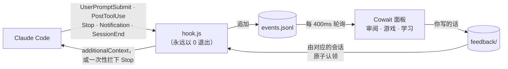

<div align="center">

# Cowait

**用 Claude Code 写代码，一半时间都在等。Cowait 让你把这段时间花在最值得的事上：审 Claude 刚写的代码。审完的奖励，是一局小游戏或几张抽认卡。**

[English](README.md) · **简体中文**


<p>


<a href="LICENSE"></a>
</p>

<h3>
<a href="#快速开始">快速开始</a> ·
<a href="#它是怎么工作的">它是怎么工作的</a> ·
<a href="#三个模式">三个模式</a> ·
<a href="#两种货币">两种货币</a> ·
<a href="#已知限制">已知限制</a>
</h3>

</div>

<br>

你敲下一句 prompt，Claude Code 开始读文件、改代码、跑测试，而你……盯着那个转圈的动画。
三十秒、两分钟，有时候十分钟。一天几十次，这些时间就这么没了。

已经有一波工具盯上了这段时间：有的把它做成小游戏，有的当成广告位卖，有的在旁边教你冷知识。
但它们有同一个盲点：**都在把你从工作里拉走**，而且大多按“等了多久”给奖励，
一个空转二十分钟、什么都没干成的回合，反而让人最爽。

Cowait 反过来想。等 Claude 干活时，最有价值的事其实是**看看它在干什么**，
没人看过的 AI 代码才是 agent 编程真正的隐性成本。所以 Claude 每改一个文件，
旁边的面板就多一张 diff 卡片，同一个文件接着改会合到同一张卡上。按一个键标“没问题”，或者打一句话
（“这里别改成 201，前端依赖 200”），**Claude 下一步操作时就会看到这句话，不用打断它**，送到了面板也会告诉你。
待审的看完了，同一个面板里还有回合制卡牌小游戏和抽认卡，而开游戏的能量靠审代码来赚。

> [!TIP]
> 没装 Claude Code 也能先试：`cowait demo` 会模拟一个正在干活的 Claude，三个模式都能点一遍。
> Cowait 完全在本地运行：hook 把事件写进你硬盘上的日志，面板去读它。除非你让 AI 出题，否则什么都不会发出去。

<details>
<summary><b>目录</b></summary>

- [功能亮点](#功能亮点)
- [快速开始](#快速开始)
- [它是怎么工作的](#它是怎么工作的)
- [三个模式](#三个模式)
- [两种货币](#两种货币)
- [自动模式](#自动模式)
- [命令](#命令)
- [配置](#配置)
- [数据放在哪](#数据放在哪)
- [开发](#开发)
- [已知限制](#已知限制)
- [License](#license)

</details>

---

## 功能亮点

<table>
<tr>
<td width="33%" valign="top"><b>边等边审</b><br>Claude 改的每个文件都变成一张带真实行号的 diff 卡片，之后对同一个文件的修改会合到这张卡上。<code>y</code> 通过，<code>n</code> 写一句话给 Claude，积压太多时连按两次 <code>S</code> 全部跳过。</td>
<td width="33%" valign="top"><b>不打断也能纠偏</b><br>针对某张卡写一句（<code>n</code>），或者随时想到什么就写（<code>m</code>）。话会在 Claude 下一次调用工具后送到它面前，只送给对应项目里的会话，送达后面板会告诉你。不用按 Esc，不丢进度。</td>
<td width="33%" valign="top"><b>先审后玩</b><br>开一局游戏要花 ⚡ 能量，能量只能靠审代码和刷卡赚。摸鱼和监督 AI 是同一个循环。</td>
</tr>
<tr>
<td width="33%" valign="top"><b>按成果给奖励，不按时长</b><br>💰 金币只看 Claude 的成果：真正动手干活的一轮 +3，测试通过再 +10。等再久也不会多给。</td>
<td width="33%" valign="top"><b>扫一眼不算审过</b><br>改动还没来得及看清就按下的 <code>y</code>，卡片照样通过，但不加能量，也不计入审阅覆盖率。团队负责人看到的那个数字才有意义。</td>
<td width="33%" valign="top"><b>为等待设计的游戏</b><br>捉虫地牢：回合制卡牌 roguelike，一个动作一个按键，每一步都自动存档。Claude 一干完就能放下，新一轮开工也不会把你从战斗里拽走。</td>
</tr>
<tr>
<td width="33%" valign="top"><b>看懂 Claude 刚写的代码</b><br>5 个内置卡组，加上 AI 按任意主题出题，或者直接用 Claude 刚改的代码出题，帮你真正看懂它。</td>
<td width="33%" valign="top"><b>挑对模式，不错过 Claude</b><br>有待审的先审，等得短就刷卡，等得长就玩。Claude 干完或需要你确认时面板会响铃，并告诉你这一轮干了什么。</td>
<td width="33%" valign="top"><b>放心安装</b><br>改 <code>settings.json</code> 前先备份，不碰你自己的 hooks，卸载得干干净净。hook 永远以 0 退出、几毫秒内结束，不可能卡住 Claude。</td>
</tr>
</table>

## 快速开始

需要 **Node.js 20+** 和 Claude Code，别的都不用装：Cowait 打包成了 `dist/` 里两个自包含的文件，
不需要 `npm install`，也不用下载任何依赖。

```bash
git clone https://github.com/JaspinXu/Cowait.git
cd Cowait
npm install -g .     # 把 cowait 命令加到 PATH（也可以跳过，直接 node dist/cli.js）

cowait install --project   # 先在一个项目里试：只写这个项目的 .claude/settings.local.json
cowait install             # …或者对所有项目生效：先列出要改什么、问你确认、自动备份
cowait doctor              # 自检：Node、hooks，并真的跑一次 hook
```

重启正在运行的 Claude Code 会话让 hooks 生效，然后**在 Claude Code 旁边**打开面板（界面按窄分屏设计，60 列以上都能用）：

| 终端 | 做法 |
|---|---|
| Windows Terminal | `cowait split`：在右侧分屏打开面板 |
| tmux | `cowait split` |
| 其他 | 再开一个标签页或窗口，运行 `cowait` |

只想先看看？运行 `cowait demo`（或 `cowait demo --fast`）。还没接入就打开了面板？它会告诉你怎么接。

> [!NOTE]
> 用 clone 方式安装时，所有数据都存在 `<安装目录>/data` 里。比如克隆到 `G:\`，
> 除了 Claude Code 的 `settings.json` 里多出的几行配置，系统盘上一个字节都不会多写。

## 它是怎么工作的



- **hook** 是一个没有任何依赖的小脚本，Claude Code 在 5 个事件上调用它。它把 payload 压成一条紧凑的事件追加到日志里：你的 prompt 原文、Claude 读过的文件内容都不会存，改动会截断。它永远不会卡住 Claude：始终以 0 退出，并带 4 秒硬超时。
- **面板**把日志折叠成状态：会话忙/闲、每轮耗时、diff 卡片、奖励结算。核心是一个纯函数 reducer，单独有测试。面板关着时发生的事，重新打开后会安静地补上，不响铃也不弹提醒。
- **你写给 Claude 的话**通过一个小文件夹传递，每条都标着它属于哪个项目、哪个 Claude 会话。hook 只认领写给自己会话的、或者属于自己所在项目的留言，所以同时开着两个会话时，A 项目的话不会被送进 B 项目。认领用的是原子重命名，所以并行的工具调用也不会重复送达。工具调用之后，这些话以 `additionalContext` 送到 Claude 面前；如果 Claude 正要结束，Cowait 会**只拦一次** Stop（有 `stop_hook_active` 保护，不可能死循环），让它先处理；如果 Claude 已经闲着，就跟你下一条 prompt 一起带过去。
- **测试识别**：把每条 Bash 命令按 `&&`、`;`、`|` 拆成段逐段判断（`npm test`、`pytest`、`go test`、`cargo test`、`uv run pytest`、`./gradlew test` 等），再读测试框架的汇总行判断通过与否。

这套流程在 **Linux 和 Windows 11** 上都跟真实的 Claude Code 会话完整跑通过：在面板里写的话送达后 Claude 照做了（加上了留言要求的那行注释），它的 Edit 带着真实行号进来，`npm test` 被判定为通过。在 Windows 上 hook 每次大约 47 毫秒，其中 39 毫秒是 Node 自身的启动时间。

## 三个模式

`Tab` 切换模式，`m` 给 Claude 留言，`a` 开关自动模式，`?` 帮助，`q` 退出。

### 审阅


Claude 改的每个文件都是一张卡片：文件、增删行数、多久以前、diff 本身，太长的代码行会折行显示而不是被截断。
你还没看的时候 Claude 又改了同一个文件，新的修改会接在这张卡后面（标着“第 2 处”“第 3 处”……），一个文件只做一次判断。
`y` 没问题（+1⚡），`n` 写一句话给 Claude（+2⚡），`s` 跳过，连按两次 `S` 跳过整个队列，`←/→` 换卡，`↑/↓` 滚动。

标题栏会实时显示 **AI 代码人工审阅覆盖率**，也就是团队负责人真正关心的那个数（`cowait stats` 里也能看）。
扫一眼不算数：卡片出现后还没来得及看清（0.6 秒，再按改动行数加一点，最多 4 秒）就按的 `y`，卡片照样通过，但不加能量，也不算审过。

### 游戏：捉虫地牢


你是一名调试员，往下打穿 6 层 Bug，最后修好「栈溢出」。每个敌人都对应一种真实的 Bug：
**海森堡虫**每回合会躲开你的第一下，除非你先用 `console.log` 观测它；**内存泄漏团**每回合都在长大；
**竞态条件**的意图看不透；**死锁守卫**一回合锁死、一回合重击。手牌全是开发者的日常：**小黄鸭**、
**git bisect**（敌人易伤时伤害翻三倍）、**结对编程**（下一张攻击牌伤害翻倍）、**rm -rf**（20 伤害，自己也掉血）、
**周五上线**（14 伤害，顺便往牌组里塞一张「线上事故」）。

全程回合制，每按一个键就存档。平衡性有测试：一个简单的贪心机器人裸装通关率约 44%，满装备约 94%。

### 学习


基于间隔重复（Leitner 盒子），内置 5 个卡组：Git 进阶、网络与 HTTP、操作系统与并发、LLM 与 Agent、系统设计，中英双语。另外：

- `t`：输入任意主题，AI 出 12 张卡。
- `g`：AI 根据 **Claude 刚刚的改动**出题：改了什么、为什么改、涉及哪些 API、哪里值得再确认。最新的代码优先交给模型。

AI 出题优先用 `ANTHROPIC_API_KEY`；没有的话就用你已经登录的 `claude` 命令（`claude -p`，并且会让 Cowait 自己的 hooks 忽略这次调用）。一眨眼就打分的卡不加能量。

## 两种货币

| | 怎么赚 | 怎么花 |
|---|---|---|
| ⚡ **能量** | **靠你自己**：通过一处改动 +1，针对改动给 Claude 写一句话 +2，刷一张卡 +1，每天第一次打开 +5，通关地牢 +5。扫一眼就过、一眨眼就打分的不算 | 开一局捉虫地牢（默认 3⚡，可配置，`0` 即免费畅玩） |
| 💰 **金币** | **只看 Claude 的成果**：用了工具、真正干活的一轮 +3，这一轮测试通过再 +10。只聊天不干活的一轮，等多久都是 0 | 永久装备：人体工学椅、降噪耳机、意式咖啡机、双显示器、机械键盘 |

## 自动模式

每轮 Claude 开工时，Cowait 预测这一轮要多久（同一目录下最近几轮耗时的中位数），然后挑模式：

1. 有待审的改动就先**审阅**；之后有新改动进来也会切回审阅（正在战斗或正在打字时除外）
2. 预计等得短（默认 45 秒以内）就**学习**
3. 否则，能量够就**游戏**

新一轮开工不会把你从战斗里拽走；审完队列后，只有你还停在审阅页时面板才会自动换模式。
Claude 干活时，标题栏会显示这一轮已经用了多久、预计要多久；超过平时的长度后，预计会跟着往后推，或者直接显示“比平时久”。

Claude 完成或需要你确认时，面板会响铃并弹出提醒，告诉你这一轮干了什么（改动几处、测试过没过、拿了多少金币、还剩几张待审）。
弹出后第一个按键只用来关掉提醒，不会误打出一张牌；而你正在打字时弹出的提醒，不会吃掉你的任何一个字。

## 命令

| 命令 | 作用 |
|---|---|
| `cowait` | 打开面板 |
| `cowait install [--project] [--statusline] [--force] [--yes]` | 先列出会改哪些东西，问你确认后才动手。把 hooks 加到 `~/.claude/settings.json`；加 `--project` 则只装到当前项目的 `.claude/settings.local.json`。`--statusline` 同时启用 Claude Code 状态栏（模型 · 目录 · ⚡ 💰 · 待审张数）；已有自定义状态栏时默认保留，除非加 `--force`，卸载时会还原 |
| `cowait uninstall [--project]` | 移除 Cowait 的 hooks，其他配置原样保留 |
| `cowait doctor` | 自检 Node、hook 脚本和配置，真实执行一次已配置的 hook 命令，并显示数据目录和 AI 出题来源 |
| `cowait demo [--fast]` | 在临时数据目录里模拟一个 Claude 会话 |
| `cowait split` | 在 Windows Terminal 或 tmux 里分屏打开面板 |
| `cowait learn "主题" [-n 12]` | 在命令行里让 AI 出一组卡 |
| `cowait stats` | 统计：轮次、测试通过、审阅覆盖率（扫一眼的不算）、转达的留言、游戏战绩 |
| `cowait config [键 值]` | 查看或修改配置 |

## 配置

`cowait config` 打印当前配置，`cowait config <键> <值>` 修改某一项。

| 键 | 默认 | 含义 |
|---|---|---|
| `lang` | `auto` | `zh` / `en` / `auto`（跟随系统语言） |
| `autoMode` | `true` | 每轮自动挑模式（面板里按 `a` 切换） |
| `runCost` | `3` | 开一局要几 ⚡，`0` 为免费畅玩 |
| `feedback` | `true` | 是否把留言转达给 Claude |
| `bell` | `true` | Claude 完成或需要你时响铃 |
| `shortWaitSec` | `45` | 预计等待短于这个秒数时用刷卡代替游戏 |
| `llm` | `auto` | AI 出题来源：`auto` / `anthropic` / `claude-cli` / `off` |
| `model` | `claude-haiku-5-5` | 使用 `ANTHROPIC_API_KEY` 时的模型 |
| `cliModel` | `haiku` | 传给 `claude -p` 的模型别名 |

## 数据放在哪

| 安装方式 | 数据目录 |
|---|---|
| clone 安装（`git clone`，装没装 `npm install -g .` 都一样） | `<安装目录>/data` |
| npm 全局安装 | `~/.cowait` |
| 自定义 | 环境变量 `COWAIT_HOME=/任意路径` |

里面有：`events.jsonl`（超过 2MB 自动滚动清理）、`state.json`、`config.json`、`feedback/`（等着送给 Claude 的留言）、`decks/`（AI 生成的卡组）。
**不会存的**：你的 prompt 原文、Claude 读过的文件内容、命令输出。改动内容会截断到几千字以内。
除非你让 AI 出题（会把主题发给模型；按 `g` 时会发送最近几处 diff），否则任何东西都不会离开你的电脑。

## 开发

用 AI agent（Claude Code、Codex 等）接手开发时，先读 [`AGENTS.md`](AGENTS.md)：约定、架构、踩过的坑、路线图都在里面。项目从零开始和之后每一轮改进的完整经过在 [`docs/history/`](docs/history/)。

```bash
npm install       # 只装开发依赖（TypeScript、Ink、React、esbuild、Vitest）
npm test          # 先打包，再跑 104 个测试：hook 协议、留言路由、reducer、安装器、游戏平衡、60 列窄屏界面
npm run build     # 类型检查 + esbuild 打包成 dist/cli.js 和 dist/hook.js（已提交，clone 下来就能用）
npm run media     # 用真实面板重新录制 docs/media 里的配图（需要 Chrome 或 Edge，以及 ffmpeg）
node dist/cli.js demo
```

```
src/
  hook.ts            Claude Code 调用的 hook（无依赖，快路径）
  events.ts          hook payload → 紧凑事件
  feedback.ts        留言队列：原子认领，按项目和会话投递
  testdetect.ts      这条 Bash 命令是不是在跑测试、过没过
  install.ts         settings.json 的合并与还原
  text.ts            窄面板里的中英文折行
  engine/            reducer、经济系统、等待预测、diff 渲染、存储
  game/              捉虫地牢（纯函数、带种子、可序列化）
  learn/             间隔重复、内置卡组、AI 出题
  ui/                Ink 组件：App、Review、Game、Learn
scripts/media/       用真实面板录制 README 配图
```

## 已知限制

- **需要第二个窗格。** Claude Code 占着自己的终端，Cowait 只能待在旁边。`cowait split` 目前只能自动分屏 Windows Terminal 和 tmux。
- **装好后要重启 Claude Code。** 正在运行的会话不会重新加载 hooks。
- **在一轮快结束时留的话，会让 Claude 多跑一轮。** Stop hook 就是这样让它处理你的意见的。不想要可以 `cowait config feedback false`。
- **被你中断的回合。** 按 Esc 打断时 Claude Code 不会发 Stop 事件，Cowait 会在静默 15 分钟后把会话标为空闲。
- **“扫一眼”是启发式判断。** 只看卡片在屏幕上停留了多久，不知道你的眼睛在看哪。
- **测试识别是启发式的。** 不认识的测试工具会被当成普通命令（不加奖励，也不扣）。
- **失败命令。** 取决于 Claude Code 版本，非零退出的命令可能不会触发 `PostToolUse`，这时 Cowait 只是不发测试奖励。
- **同一时间只能开一个面板。** 用锁文件防止第二个面板重复结算奖励。

## License

[MIT](LICENSE)
